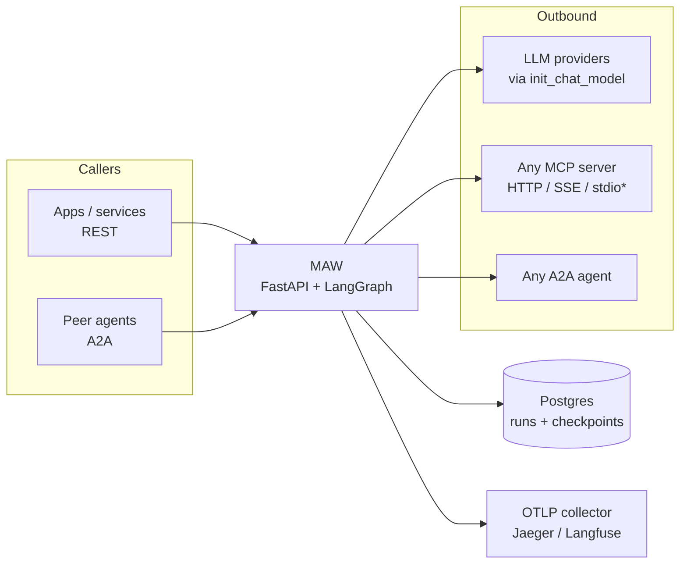
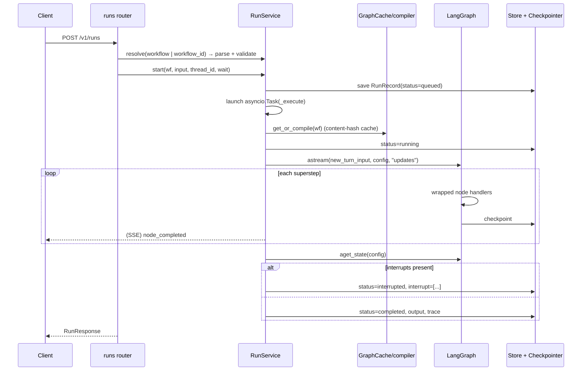

# MAW architecture

## System context


\*stdio only from the trusted server-side connections file.

## Layers and dependency rule

```
api ──► runtime ──► engine ──► connectors / functions / schema ──► observability / settings
a2a_server ──► runtime
```

Lower layers never import upper layers, and nothing under `src/` imports `mocks/`.

| Package | Responsibility |
|---|---|
| `schema/` | The workflow contract (Pydantic, `extra="forbid"`), reference-format translation, graph validation |
| `engine/` | State and reducers, the path/template resolver, routing, models, node handlers, the compiler |
| `connectors/` | Trusted/untrusted connection registry, secrets, host allowlist, MCP and A2A clients |
| `functions/` | Registry of local functions and the built-ins |
| `runtime/` | Run records and stores (memory, Postgres), the catalog, persistence, `RunService` |
| `a2a_server/` | Agent cards, mounting, and the executor that runs workflows for A2A callers |
| `api/` | FastAPI app, lifespan, auth middleware, error mapping, routers (HTTP only) |
| `observability/` | JSON logging with context ids, Prometheus metrics, OpenTelemetry spans |

**Key principle:** REST sync, REST async, SSE streaming and the A2A server all call the same
`RunService` methods. There is exactly one execution path.

## Run lifecycle



Runs on the same thread are serialized by a per-thread lock; a semaphore caps concurrent
executions (`MAW_MAX_CONCURRENT_RUNS`). Event subscribers are attached **before** a run is
launched, so streams never miss the first events. Synchronous waits are shielded: if an HTTP client
disconnects, the run still finishes and is recorded.

## Run status machine

```
queued ──► running ──► completed
              │  ├──► failed
              │  ├──► cancelled
              │  └──► interrupted ──(resume)──► running
              └── (process dies) ── on restart: recover() ──► running
interrupted ──(cancel)──► cancelled
```

Terminal states: `completed`, `failed`, `cancelled`.

## Durability

With `MAW_DATABASE_URL`, LangGraph's `AsyncPostgresSaver` checkpoints every superstep and run
records live in `maw_runs`. On a clean shutdown, in-flight runs are left `running` rather than
`cancelled`. At startup, `recover()` relaunches every `running`/`queued` run: from its last
checkpoint if one exists (completed nodes are not re-run), otherwise from scratch. A run paused by a
`human` node survives any restart and can be resumed through REST or A2A.

## State

Every state key has a reducer, so parallel branches can write the same key in one superstep:

| Key | Reducer | Meaning |
|---|---|---|
| `input` | last value | The run input |
| `messages` | `add_messages` | Conversation; **carries over** between runs on a thread |
| `nodes` | merge dicts | Per-node results, keyed by node id |
| `output` | last value | Latest result of a node with `write_output: true` |
| `vars` | merge dicts | Scratch space (e.g. remote A2A context ids); **carries over** |
| `visits` | sum counts | Loop guard |
| `errors` | append | Errors from `on_error: continue` nodes |
| `trace` | append | Per-node execution records |

Each new run on a thread resets `nodes`, `visits`, `errors`, `trace` and `output`.

## Adding a node type

1. Add a Pydantic model to `schema/workflow.py` (extend `_NodeBase`, add a `type` literal) and add
   it to the `Node` union.
2. Write a handler `async (node, state, wf, ctx) -> NodeOutcome` and register it in
   `engine/nodes/__init__.py` `HANDLERS`.
3. If it references a connection or function, extend `validate_graph`.

The wrapper (`engine/nodes/base.py`) gives every handler retries, timeouts, `on_error`, the loop
guard, tracing, metrics and trace records for free.

## Security model

A submitted workflow is caller-controlled (**untrusted**); the server-side connections file is
operator-controlled (**trusted**).

| Threat | Control |
|---|---|
| A submitted workflow exfiltrates server secrets | Only `${secret:X}` → `MAW_SECRET_X`; `${env:…}` is rejected outside the trusted file |
| A submitted workflow runs commands on the host | `stdio` MCP servers only from the trusted file |
| SSRF / calls to arbitrary hosts | `MAW_ALLOWED_OUTBOUND_HOSTS` checked for MCP URLs, A2A URLs, **the interface URLs inside A2A agent cards**, and model `base_url`s |
| Keys pasted into workflow JSON | Literal `api_key` rejected unless `MAW_ALLOW_INLINE_API_KEYS=true` |
| Code injection via the calculator | AST whitelist, never `eval`; bounded exponent and length |
| Reaching interpreter internals through paths | Path resolution refuses `_`-prefixed attributes |
| Unbounded loops / cost | `max_visits`, `recursion_limit`, `max_tool_calls`, per-node `timeout_s`, `max_concurrent_runs` |
| Unauthenticated access | Optional API keys (constant-time compare); only probes, metrics, docs and agent cards are public |
| Typos silently ignored | `extra="forbid"` everywhere |
| Secrets leaking through APIs | `/v1/connections` omits headers and env; secrets are resolved per call and only ever appear in cache keys as hashes |
| Container | Runs as non-root uid 10001 |

`MAW_ALLOWED_OUTBOUND_HOSTS` defaults to `*` for development and **must** be set in shared
deployments.

## Observability

- **Logs:** JSON by default (`MAW_LOG_JSON`), with `run_id`, `workflow_id` and `node_id` injected
  from context variables.
- **Metrics** (`/metrics`): `maw_runs_total`, `maw_run_duration_seconds`, `maw_runs_in_flight`,
  `maw_node_duration_seconds`, `maw_node_retries_total`, `maw_llm_calls_total`,
  `maw_llm_call_duration_seconds`, `maw_llm_tokens_total`, `maw_mcp_calls_total`,
  `maw_mcp_call_duration_seconds`, `maw_a2a_calls_total`, `maw_a2a_call_duration_seconds`,
  `maw_graph_cache_total`, `maw_graph_compile_seconds`. Labels are low-cardinality.
- **Traces:** spans `workflow.run`, `node.<id>`, `llm.invoke`, `llm.tool_call`, `mcp.list_tools`,
  `mcp.call_tool`, `a2a.get_card`, `a2a.send_message`. For Langfuse, set
  `OTEL_EXPORTER_OTLP_ENDPOINT=<langfuse>/api/public/otel` and
  `OTEL_EXPORTER_OTLP_HEADERS=Authorization=Basic <base64(pk:sk)>`.

## Future work (seams kept, not built)

Multi-tenancy (`tenant_id` on records, cache keys, registry and auth), signed workflow releases
(verify a signature over `content_hash()`), cross-replica cancel and events (Redis pub/sub instead
of in-process maps), token streaming (`stream_mode="messages"`), sub-workflow nodes, A2A push
notifications and durable A2A tasks (`DatabaseTaskStore`), run-time model overrides, and a UI as a
separate app.

## Pin notes

Verified on 2026-10-15 against the installed versions (Python 3.12.3):

| Package | Version |
|---|---|
| langgraph | 1.2.15 |
| langchain | 1.4.6 (langchain-core 1.6.10) |
| langchain-mcp-adapters | 0.3.2 |
| mcp | 1.30.0 |
| a2a-sdk | 1.2.2 |
| fastapi | 0.143.2 (starlette 1.8.0) |
| pydantic | 2.14.1 |
| langgraph-checkpoint-postgres | 3.2.0 (psycopg 3.3.6) |

Findings, keyed to the build spec's trap list:

- **T1 — `mcp` is pinned `<2`.** `langchain-mcp-adapters` 0.3.x declares `mcp>=1.24` with no upper
  bound but fails at import on mcp 2.x. The MCP wire protocol negotiates versions, so a 1.x client
  still talks to servers built on SDK 2.x.
- **T2 — the 1.x server class is `mcp.server.fastmcp.FastMCP`.** Its `settings` expose `host`,
  `port` and `streamable_http_path` (default `/mcp`). FastMCP only emits `structuredContent` when it
  can derive an output schema (e.g. `-> dict[str, Any]`, not bare `dict`), and enables DNS-rebinding
  protection at construction for its default host 127.0.0.1.
- **T3/T4 — adapter.** `MultiServerMCPClient` has `session(server_name)` (raw session for
  deterministic calls) and `get_tools(*, server_name=None)`. Connection TypedDicts:
  `StreamableHttpConnection` (`transport, url, headers, timeout, …`), `SSEConnection` (`timeout` is a
  float), `StdioConnection`, `WebsocketConnection`. Transport errors surface wrapped in anyio
  `ExceptionGroup`s.
- **T5 — A2A 1.x protobuf types.** Field lists match the spec. `StreamResponse` has one oneof,
  `payload`, over `task | message | status_update | artifact_update`. `TaskState` also has
  `TASK_STATE_UNSPECIFIED`. Data parts are protobuf `Struct`s, so integers come back as floats.
- **T6 — server wiring** as in the spec. `TaskUpdater.add_artifact` also accepts `extensions=`.
  `create_agent_card_routes` accepts `card_modifier`, used to serve an up-to-date card.
- **T7 — confirmed bug.** `create_rest_routes(handler, path_prefix=…)` returns a
  `Mount('/{tenant}', …)` at the app root. MAW filters `Mount` routes out.
- **T8 — client.** `A2ACardResolver.get_agent_card(relative_card_path=None, …)`. A follow-up
  message on a task in `input_required` reaches `execute()` with `current_task` in that state.
- **T9 — LangGraph.** With branches of unequal length, `defer=True` ran the join once after both
  branches; without it the join ran twice. Parallel writes to a key without a reducer raise
  `InvalidUpdateError`. `GraphInterrupt` is a subclass of `GraphBubbleUp`.
- **T10 — `init_chat_model`** signature matches; provider SDKs raise their own exception types for
  missing credentials (e.g. `openai.OpenAIError`).
- **T11 — psycopg 3** runs one statement per `execute()`; the pool uses `autocommit=True`,
  `prepare_threshold=0`, `row_factory=dict_row`.
